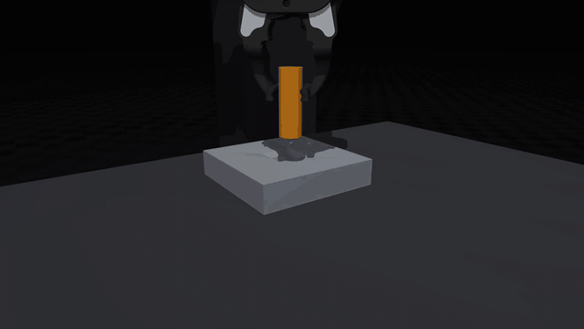
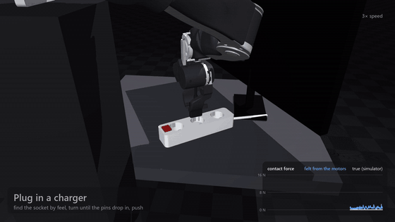
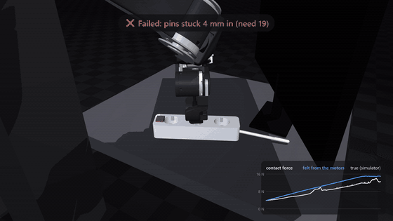
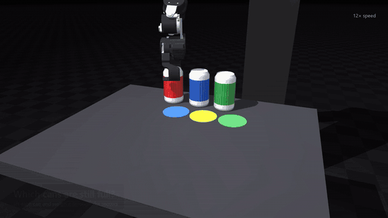
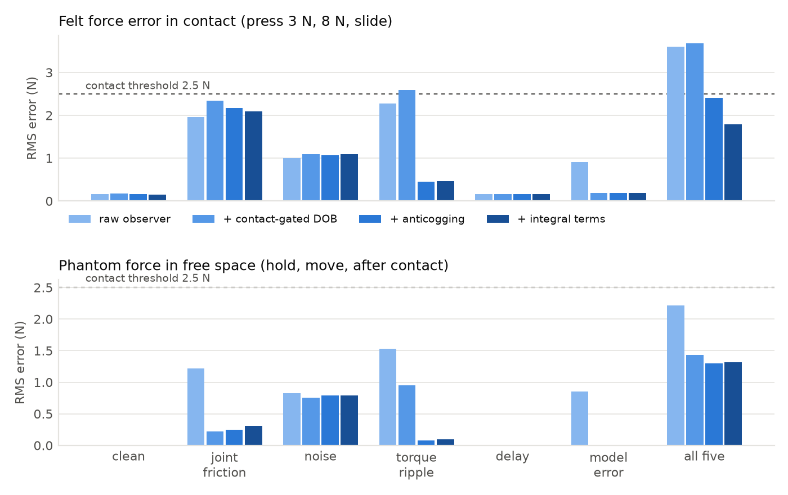
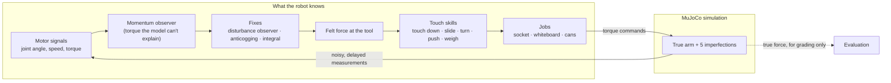

<div align="center">

# Blind Touch

**Can a low-cost robot arm feel what it touches, without a force sensor?**



*The arm presses on a plate. **Blue** is the force it feels through its own motors. **White** is the true force from the simulator.*

</div>

---

## The idea in 30 seconds

Robots usually feel force with an expensive force/torque sensor at the wrist. But every motor already "feels"
something: when the arm pushes on a table, the motors have to work harder. If you know how hard they *should* be
working, the difference is the contact force.

The catch is that **real motors lie.** Joint friction, torque ripple (cogging), sensor noise, delay and a slightly
wrong model of the arm all look like forces that aren't there.

**Blind Touch** simulates all five of those problems on an [OpenArm v2](https://github.com/enactic/openarm) in
MuJoCo, builds the fixes, and then tests whether the result is good enough for real jobs. The arm has **no force
sensor and no camera at the moment of contact**. Everything it feels comes from joint angles, speeds and motor
torques.

## Three real jobs, felt through the motors

Each clip shows one success and one **real failure**. Failures aren't cut out.

<table>
<tr>
<td width="33%" valign="top">

**Plug in a charger** behind the TV



Find the socket by feel, turn until the pins drop in, push.
**80 %** of 50 trials.

</td>
<td width="33%" valign="top">

**Erase a sloped whiteboard**



Feel the board's angle, then wipe with a steady 8 N.
**90 %** of 50 trials.

</td>
<td width="33%" valign="top">

**Which cans are still full?**



Lift each can and weigh it through the motors.
**90 %** of 50 trials.

</td>
</tr>
</table>

In every trial the motor imperfections are switched on at random. A run only counts as a success if the job is
done **and** the true contact force stayed within the job's force budget.

> 🎬 **Full 90-second video** (with sound): see the [Releases page](../../releases).

## What made it work

| Problem (simulated) | What it does to the felt force | Fix |
|---|---|---|
| Wrong model of the arm (mass, centre of mass) | a constant fake push | **Disturbance observer:** learns the arm's own error in free air, freezes the moment it touches |
| Torque ripple (cogging) | a wobble that repeats with the joint angle | **Anticogging map:** the arm sweeps each joint once and measures its own ripple |
| Small steady errors | the tool ends up a few mm off | **Integral correction** with anti-windup |
| Joint end stops | an end stop feels like a push | Keep the joints away from their limits (null-space) |
| Joint friction (stiction) | eats part of the motor's effort | **Not solved:** see below |

With all five problems switched on:

- the **error in the felt force halves**: 3.6 N → 1.8 N
- **false "touches" in free air** drop from 37 % to 4 %
- model error alone drops from 0.9 N to 0.06 N, and ripple from 2.3–2.5 N to 0.3–0.8 N

<p align="center"></p>

Full tables: [`results/sensing.md`](results/sensing.md).

## What still fails (honest limits)

- **Joint stiction.** When a joint sticks, part of the motor's effort goes into friction, and no motor signal can
  tell that apart from a real contact force (about 2–2.5 N). With friction on, plugging in drops from 89 % to 50 %.
- **Placement it wasn't built for.** On new seeds and wider worlds, with the code unchanged, success drops:
  socket 77 % → 60 % when it can be anywhere within ±4 cm, and whiteboard 90 % → 67 % with the board turned and
  moved twice as far. With all five imperfections on at once: socket 40 %, whiteboard 80 %, cans 47 %. Full table:
  [`results/robustness.md`](results/robustness.md).
- **The jobs are hand-built procedures** on a shared set of touch skills, not learned policies.
- **Simulation only.** The next step is a real arm.

## How it works



The simulator's true contact force is **only used to grade** the runs. The robot never sees it. More detail is in
[`docs/how-it-works.md`](docs/how-it-works.md).

## Repository layout

```
blindtouch/
  sim/        the arm, the five imperfections, impedance control, ground-truth contacts
  sensing/    momentum observer, anticogging calibration
  skills/     the touch layer: touch down, slide, turn, push, weigh, recover from mistakes
  jobs/       socket, whiteboard, cans (+ force audit and budget)
  scenes/     real-dimension props and MJCF scene generation; OpenArm v2 meshes
  eval/       job evaluation, robustness check, sensing report
  video/      re-render any evaluated run as video
results/      every number above, as Markdown tables and raw JSON
media/        the clips in this README
tests/        unit tests (observer, simulation, realism switches)
```

## Run it yourself

Python 3.12 is tested. Rendering video needs an OpenGL context.

```bash
pip install -e .            # or: pip install -r requirements.txt
pytest                      # unit tests, ~15 s

# one job, one seed (the same seed always gives the same episode)
python -c "from blindtouch.jobs.socket import SocketJob; print(SocketJob().run(800004).row(800004))"

# the evaluations behind the numbers above
python -m blindtouch.eval.jobs --jobs socket whiteboard cans --trials 50 --workers 4
python -m blindtouch.eval.sensing --n 20 --workers 4
python -m blindtouch.eval.robustness --trials 30 --workers 4

# videos
python -m blindtouch.video.job_clip socket --seeds 800004 800032
python -m blindtouch.video.showcase          # the full 90 s video -> out/
```

## Credits

- Robot model: [OpenArm v2](https://github.com/enactic/openarm) by Enactic (Apache-2.0); see
  [`NOTICE`](NOTICE) for what was changed.
- Physics: [MuJoCo](https://mujoco.org).
- Momentum observer: De Luca & Mattone (2003), Haddadin et al. (2017). Anticogging: Piccoli & Yim (2014).

Built by **Ahmed Sleem**. Simulation only.
